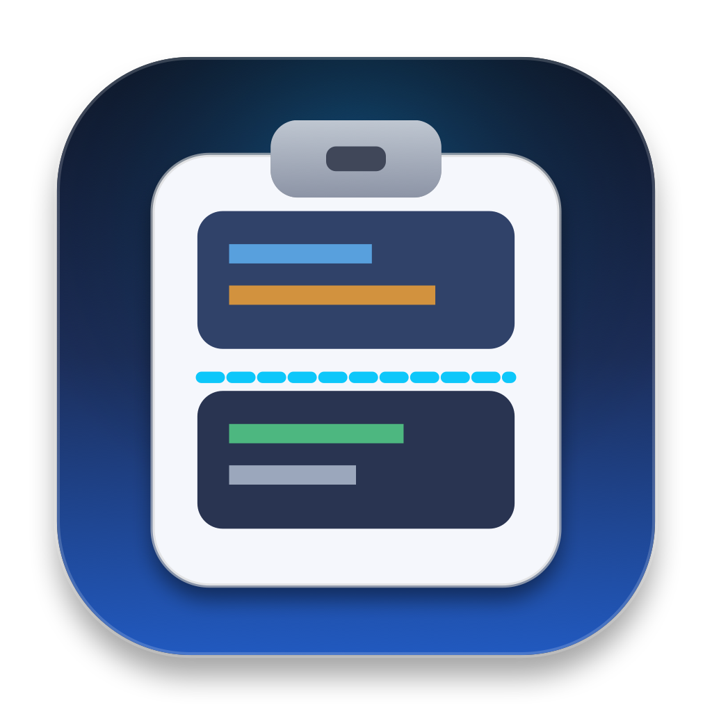
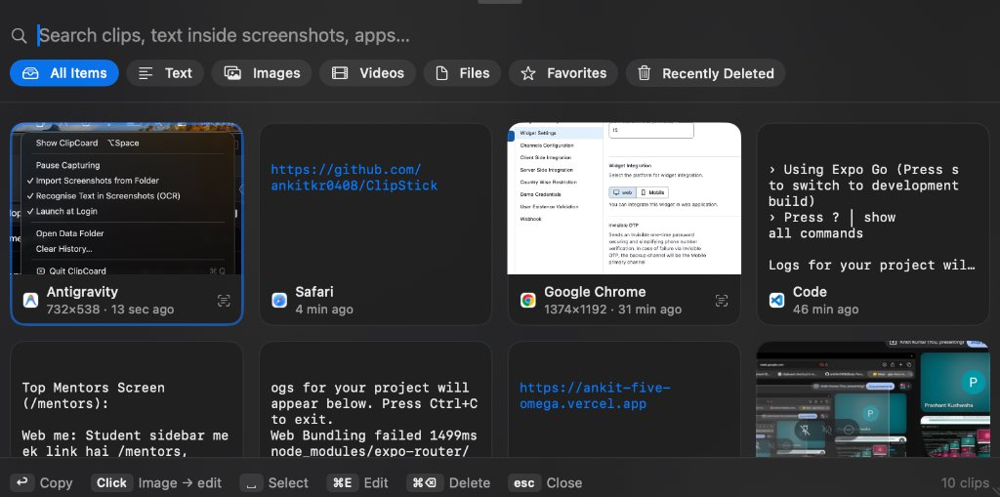
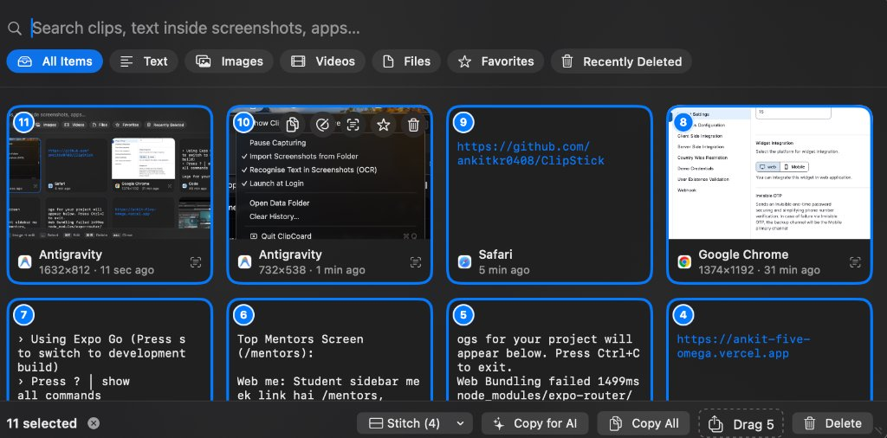
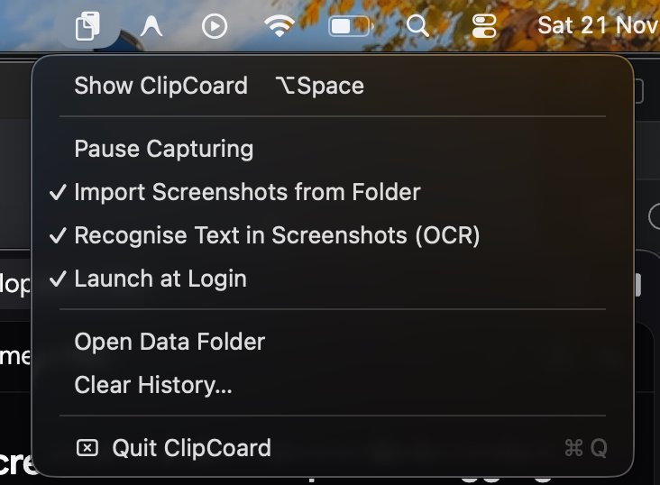

<p align="center">
  
  <br/>
  <h1 align="center">ClipStick</h1>
</p>

A lightweight, native macOS clipboard manager built in Swift and SwiftUI, designed for developer workflows, visual debugging, and AI bug analysis.

[](https://apple.com/macos)
[](https://swift.org)
[](LICENSE)

---

<p align="center">
  <a href="https://raw.githubusercontent.com/ankitkr0408/ClipStick/main/downloads/ClipStick.zip">
    
  </a>
  <br/>
  <sub><b>No Xcode, No Terminal, No Setup required.</b> Just download, unzip, and drag to Applications!</sub>
  <br/>
  <sub>👉 <b>Facing an issue or security prompt?</b> Check the <a href="SUPPORT_GUIDE.md"><b>Support & Troubleshooting Guide (with Screenshots)</b></a></sub>
</p>

> [!TIP]
> **First-Time macOS Warning?** If macOS shows *"Apple could not verify..."*, this is 100% normal for open-source Mac tools. Simply **Right-Click → Open** (or go to *System Settings → Privacy & Security → Open Anyway*). ClipStick is 100% local and offline. [See visual step-by-step instructions →](SUPPORT_GUIDE.md#scenario-1-macos-security-warning-clipstick-not-opened--cannot-verify-developer)

---

<p align="center">
  
</p>

---

## Why ClipStick?

When debugging code or reproducing UI issues, developers often take multiple screenshots in rapid succession alongside copying logs and error traces. Default clipboards only keep the latest item.

**ClipStick** runs silently in the background, automatically tracks all captures locally, and lets you batch-select multiple screenshots to merge or export directly into AI prompts (Claude, ChatGPT) or GitHub issues.

---

## Visual Tour

### Multi-Item Selection & 1-Click Stitching
Select multiple screenshots with numbered click-order badges, and merge them into a single clean collage ready for bug reports or LLMs:

<p align="center">
  
</p>

### Native macOS Menu Bar Controls
Access history, toggle folder screenshot watchers, pause capture, or configure background text recognition (OCR) with one click:

<p align="center">
  
</p>

---

## Key Features

- **Automatic Background Capture**: Intercepts screenshots and copied text without stealing window focus.
- **Multi-Select & Stitching**: Select 2 or more screenshots with checkboxes and merge them vertically or horizontally into one image.
- **Built-in Redact & Crop**:
  - **Redact**: Blackout sensitive API keys, passwords, or personal data before sharing.
  - **Crop**: Fast 8-handle crop box with rule-of-thirds grid.
  - **Annotations**: Highlight lines of code with markers, add arrows, boxes, and step counters.
- **Auto-redact secrets**: One click in the editor's Privacy menu finds API keys (Anthropic, OpenAI, GitHub, AWS, Stripe…), JWTs, private keys, emails, phone numbers and `password=…` lines via on-device OCR and blacks them out.
- **JSON / SQL formatter**: Messy JSON or one-line SQL on your clipboard gets a `{}` button on its card to copy a pretty-printed version, fully offline.
- **Colour picker & palette**: Press `Option + C` anywhere (or use the eyedropper in the HUD) to copy any pixel's HEX; the palette button on a screenshot copies its 5 dominant colours. RGB and HSL are shown too.
- **Pin to screen**: Pin any screenshot or text snippet as an always-on-top floating window for reference while you code.
- **Copy for AI / Markdown Bundle**: Formats selected logs and screenshots into structured Markdown context ready for LLMs.
- **Native Vision OCR**: Extracts text and code snippets from captured images in the background.
- **100% Local & Private**: All data is stored in local SQLite and disk storage. Zero cloud sync, zero telemetry, updates only when you ask.
- **Fluid & Resizable HUD**: Summon the floating panel anytime via hotkey (`Option + Space`), resize from the edges or bottom-right corner, and reposition via the drag handle.

---

## 🔒 Privacy & Data Safety: 100% Local, Zero Cloud

Your clipboard contains your most sensitive data — passwords, credentials, personal chats, and private source code. 

**ClipStick is designed with privacy-first architecture:**

- **Zero Cloud Sync**: Nothing is ever uploaded to the cloud or external servers. Your clips never leave your Mac.
- **Zero Telemetry or Analytics**: There are no tracking scripts, analytics SDKs, or background telemetry pings.
- **Stored Exclusively on Your Machine**: Metadata and history live inside a local SQLite database on your Mac (`~/Library/Application Support/`), and images are cached locally on your disk.
- **Updates are opt-in**: ClipStick only touches the network when you click **Check for Updates…** in the menu bar (or turn on *Check for Updates Automatically*, off by default). It sends a plain HTTPS request for `version.json` on GitHub — no identifiers, no analytics. Downloads are SHA-256 verified before the app replaces itself, and your history is kept.
- **Works 100% Offline**: Turn off Wi-Fi completely — every feature (capture, search, markup, crop, OCR, and stitching) functions with zero internet access.
- **Fully Open-Source & Auditable**: You don't have to take our word for it — the complete source code is public and transparent right here. Feel free to inspect the network calls (or lack thereof!).

---

## Requirements

- macOS 14.0 (Sonoma) or later
- Apple Silicon or Intel Mac

---

## 🚀 Installation Guide

### Option 1: Direct Download (Pre-built App — 370 KB, Zero Terminal ⭐️)

1. **[Click here to download `ClipStick.zip`](https://raw.githubusercontent.com/ankitkr0408/ClipStick/main/downloads/ClipStick.zip)**.
2. Double-click the downloaded `ClipStick.zip` file to extract `ClipStick.app`.
3. Drag **`ClipStick.app`** into your **`Applications`** folder and open it!

> **Note on first launch:** Since ClipStick is an independent open-source project, macOS Gatekeeper may show a prompt. Simply **Right-Click (or Control-Click) `ClipStick.app` → Open → Click "Open"**.

---

### Option 2: 1-Click Terminal Install (No Xcode needed)

Open **Terminal** on your Mac (`Cmd + Space` → type `Terminal` → press Enter), paste this line, and hit **Enter**:

```bash
curl -fsSL https://raw.githubusercontent.com/ankitkr0408/ClipStick/main/scripts/install.sh | bash
```

*Works on all Macs automatically, even without developer tools or Xcode!*

---

### Option 3: If you downloaded the repo ZIP (`ClipStick-main.zip`)

If you clicked GitHub's green **`<> Code` → "Download ZIP"** button:

1. Open the extracted **`ClipStick-main`** folder in Finder.
2. Simply **Double-Click on `Install.command`**!
3. Done! It automatically extracts the pre-built app into your `/Applications` folder without compiling.

---

### Option 4: Clone & Build (For Developers)

```bash
git clone https://github.com/ankitkr0408/ClipStick.git
cd ClipStick
./scripts/install.sh
```

---

## Keyboard Shortcuts

| Shortcut | Action |
|---|---|
| `Option + Space` | Toggle ClipStick overlay |
| `Return` | Copy selected item to clipboard |
| `Space` | Toggle item checkbox for batch actions |
| `Cmd + E` | Open markup and crop editor |
| `Cmd + Return` | Save annotations and copy |
| `Cmd + Backspace` | Delete clip |
| `Esc` | Dismiss overlay or cancel edit |

---

## Tech Stack

- **UI**: SwiftUI & AppKit
- **Language**: Swift 5.9+
- **Database**: SQLite3 (WAL mode)
- **Image Processing**: CoreGraphics & Apple Vision Framework

---

## License

This project is licensed under the MIT License. See [LICENSE](LICENSE) for details.
