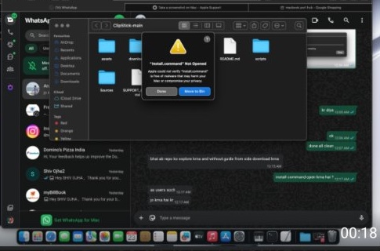
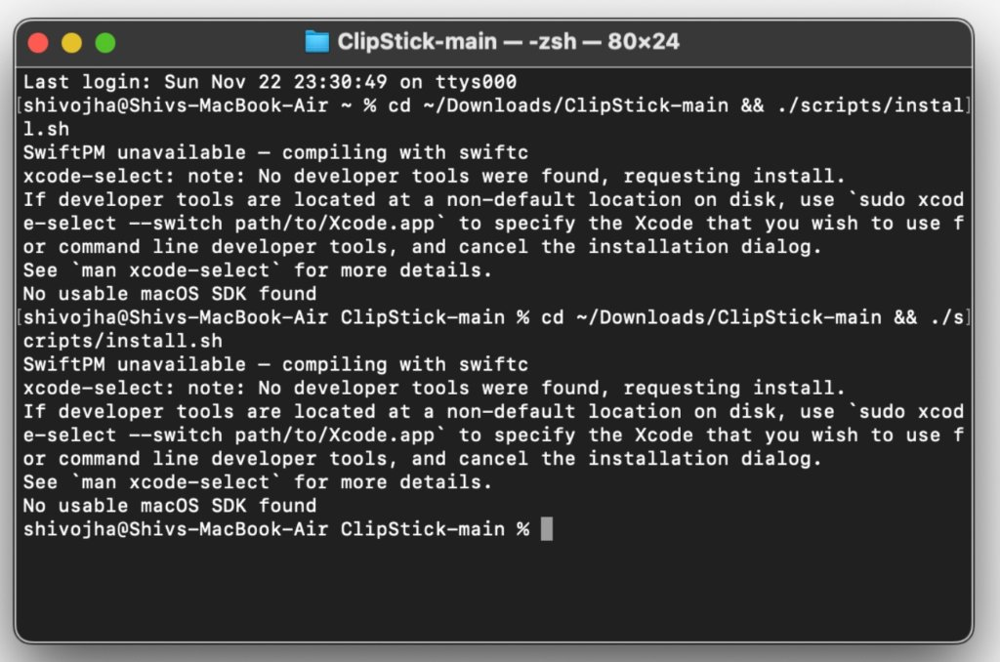

# ClipStick Support & Troubleshooting Guide 🛠️

A complete reference guide covering every common scenario for both **non-technical users** and **developers**.

---

## 🧭 Quick Links

- [Scenario 1: macOS Security Warning ("Cannot verify developer")](#scenario-1-macos-security-warning-cannot-verify-developer)
- [Scenario 2: "Where is the app? I can't find a window open!"](#scenario-2-where-is-the-app-i-cant-find-a-window-open)
- [Scenario 3: "No developer tools found" / Xcode Compilation Error](#scenario-3-no-developer-tools-found--xcode-compilation-error)
- [Scenario 4: Screenshots are not auto-importing](#scenario-4-screenshots-are-not-auto-importing)
- [Scenario 5: Apple Silicon (M1/M2/M3/M4) vs Intel Macs](#scenario-5-apple-silicon-m1m2m3m4-vs-intel-macs)
- [Scenario 6: Launch Automatically on Mac Startup](#scenario-6-launch-automatically-on-mac-startup)
- [Scenario 7: How to Clear Data or Completely Uninstall](#scenario-7-how-to-clear-data-or-completely-uninstall)

---

### Scenario 1: macOS Security Warning ("Cannot verify developer" / "Install.command Not Opened")

<p align="center">
  
</p>

#### 🛡️ Is this safe? Why does macOS show this?
- **This is 100% normal on macOS.**
- Apple displays this standard Gatekeeper alert for **any** open-source software, script, or application downloaded from GitHub or the web that does not carry an Apple Developer Enterprise Notarization ticket ($99/year fee).
- **Your privacy is completely protected:** ClipStick is **100% offline, local-only, and open-source**. It never connects to any external server, has zero analytics, and never uploads your clipboard or screenshots anywhere. You can audit every line of code directly on GitHub.

#### 🚀 How to Open It (Choose any 1 method):

##### 👉 Option A: The 2-Second Right-Click Trick (Recommended — No Terminal needed)
1. In Finder, locate **`Install.command`** (or **`ClipStick.app`** in Applications).
2. **Right-Click** (or hold the `Control` key and click, or tap with two fingers on your trackpad).
3. Click **"Open"** from the top of the right-click menu.
4. macOS will now present a modified prompt that includes an **"Open"** button.
5. Click **"Open"**! It will immediately run and install. *(You only ever have to do this once)*.

##### 👉 Option B: System Settings ("Open Anyway")
1. Open **System Settings** (Apple menu  in the top-left corner → *System Settings*).
2. Select **Privacy & Security** from the left sidebar.
3. Scroll down to the **Security** section.
4. You will see a notification: *`"Install.command" was blocked to protect your Mac`*.
5. Click the **"Open Anyway"** button next to it and enter your Mac password or Touch ID.

##### 👉 Option C: Terminal One-Liner (Power Users)
If you prefer the command line, remove the quarantine flag in one command:
```bash
xattr -cr ~/Downloads/ClipStick-main && ~/Downloads/ClipStick-main/Install.command
```

---

### Scenario 2: "Where is the app? I can't find a window open!"

#### Explanation:
ClipStick is designed as a **lightweight, distraction-free menu bar utility** (like Spotlight or Raycast). It runs quietly in your background without keeping a persistent window open on your screen.

#### How to access and use it:
1. **Global Shortcut**: Press **`Option + Space`** (`⌥ Space`) anywhere on your Mac to toggle the floating clipboard HUD.
2. **Menu Bar Icon**: Look at the top-right menu bar near your Wi-Fi, Clock, and Battery icons for the **ClipStick clipboard icon**. Click it to toggle OCR, pause capturing, or view history.

---

### Scenario 3: "No developer tools found" / Xcode Compilation Error

<p align="center">
  
</p>

#### Error text in Terminal:
```
SwiftPM unavailable — compiling with swiftc
xcode-select: note: No developer tools were found, requesting install.
No usable macOS SDK found
```

#### Why this happens:
This happens when someone runs the build-from-source script on a Mac that doesn't have Apple's Command Line Developer Tools or Xcode installed.

#### Solution:
**You do not need to install Xcode or any developer tools!**
We provide a universal pre-compiled binary that runs directly on any Mac:
1. Download the pre-built application:  
   👉 **[Download ClipStick.zip (Universal Binary)](https://raw.githubusercontent.com/ankitkr0408/ClipStick/main/downloads/ClipStick.zip)**
2. Unzip it and drag **`ClipStick.app`** directly into your **Applications** folder.
3. Open it using **Right-Click → Open** on first launch. That's it!

---

### Scenario 4: Screenshots are not auto-importing

#### How to check:
1. Click the ClipStick icon in your top menu bar.
2. Ensure **"Import Screenshots from Folder"** has a checkmark (`✓`).
3. If macOS displays a permission pop-up asking for access to your *Desktop* or *Documents* folder, click **Allow**.

> ClipStick checks the default macOS screenshot location (`~/Desktop` or custom save folder) and automatically captures newly saved screenshots in real time.

---

### Scenario 5: Apple Silicon (M1/M2/M3/M4) vs Intel Macs

#### Native Universal Binary:
ClipStick is compiled as a **Universal Mach-O 64-bit Binary** supporting both:
- **`arm64`**: Apple Silicon (M1, M2, M3, M4, Pro, Max, Ultra)
- **`x86_64`**: Intel-based Macs

It runs at native speed on both architectures with zero emulation required.

---

### Scenario 6: Launch Automatically on Mac Startup

1. Click the ClipStick icon in your top menu bar.
2. Click **"Launch at Login"** so a checkmark (`✓`) appears.
3. ClipStick will now quietly start in the background every time you turn on or restart your Mac.

---

### Scenario 7: How to Clear Data or Completely Uninstall

#### Clear History & Data:
- Click the ClipStick menu bar icon → **Clear History…**
- Or click **Open Data Folder** to view local files (`~/Library/Application Support/ClipStick/`).

#### Uninstall:
1. Quit ClipStick: Click the menu bar icon → **Quit ClipStick** (`Cmd + Q`).
2. Drag `ClipStick.app` from your `/Applications` folder to the **Trash**.
3. *(Optional)* Delete user data folder:
   ```bash
   rm -rf ~/Library/Application\ Support/ClipStick
   ```

---

## Need More Help?

If you encounter any edge cases or bugs:
- Open an issue on GitHub: **[github.com/ankitkr0408/ClipStick/issues](https://github.com/ankitkr0408/ClipStick/issues)**
- Contributions, feedback, and pull requests are warmly welcomed!
